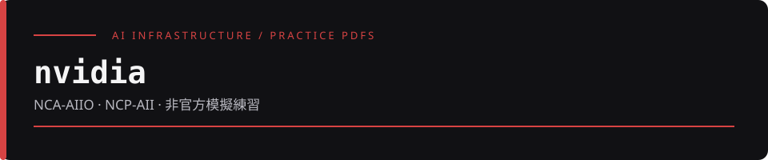

# nvidia

收錄兩份以 NVIDIA AI 基礎設施相關認證名稱為主題的模擬練習 PDF。這是閱讀與複習資料索引，不是官方考題庫、認證服務或考試答案公告。

## 文件索引

| PDF | 封面標示 | 檔案頁數 |
| --- | --- | --- |
| [NVIDIA_NCA-AIIO_50题中英双语模拟题库.pdf](NVIDIA_NCA-AIIO_50题中英双语模拟题库.pdf) | NCA-AIIO；AI Infrastructure and Operations；50 題中英雙語練習 | 15 |
| [NVIDIA_NCP-AII_75题模拟题库.pdf](NVIDIA_NCP-AII_75题模拟题库.pdf) | NCP-AII；AI Infrastructure；75 題中英雙語練習；封面列有作答欄、答案與逐題解析 | 32 |

題數與內容定位沿用文件封面，頁數取自 PDF 檔案資訊；這些數字不是現行官方考試規格。

## 如何使用

直接點選 PDF，在 GitHub 預覽或下載後用 PDF 閱讀器開啟即可，不需要安裝程式或啟動服務。可先自行作答，再對照文件內容整理待查證的觀念。

文件內的作答時間、領域比例、答案與解析都是這份練習資料的內容。若要用於實際報考或工作決策，應另外查核 NVIDIA 當時公布的考試資訊與技術文件；本儲存庫不保證內容完整、正確或持續更新。

## 來源聲明與使用界線

- NCA-AIIO 封面自述為原創練習、非官方試題或洩題；NCP-AII 封面亦明示不是 NVIDIA 官方試題或考試洩題。本頁保留兩份文件的模擬練習定位。
- 「原創」是文件內的自述，本 README 不據此確認編寫者身分、著作權歸屬或官方授權；PDF 作者中繼資料也不等同作者身分證明。
- NVIDIA 與相關認證名稱僅用於辨識文件主題，不表示本儲存庫獲得官方背書、合作或認可，也不表示作者持有相關證照。
- 原 PDF 保留不變，文件內的來源與聲明仍應一併閱讀。儲存庫未附獨立授權檔；轉載、改作或再散布前，請另行確認權利。
